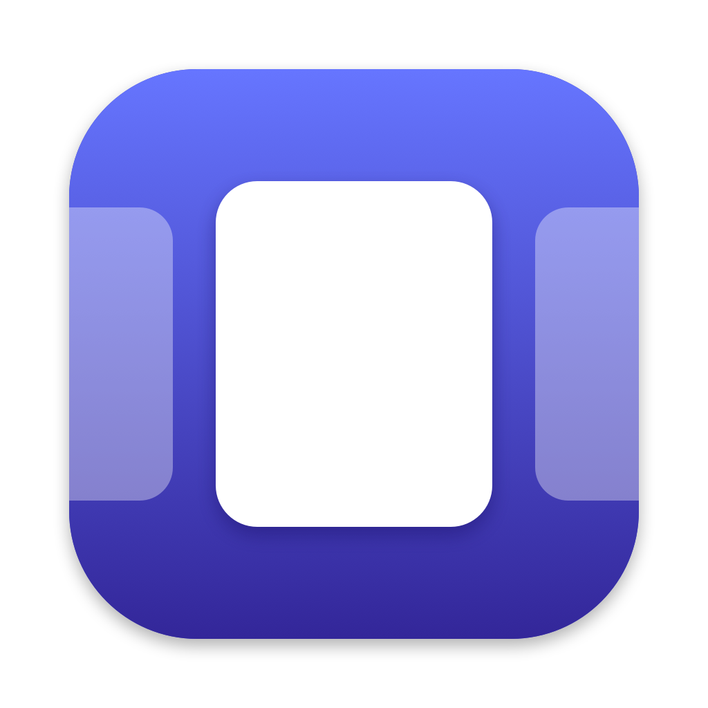
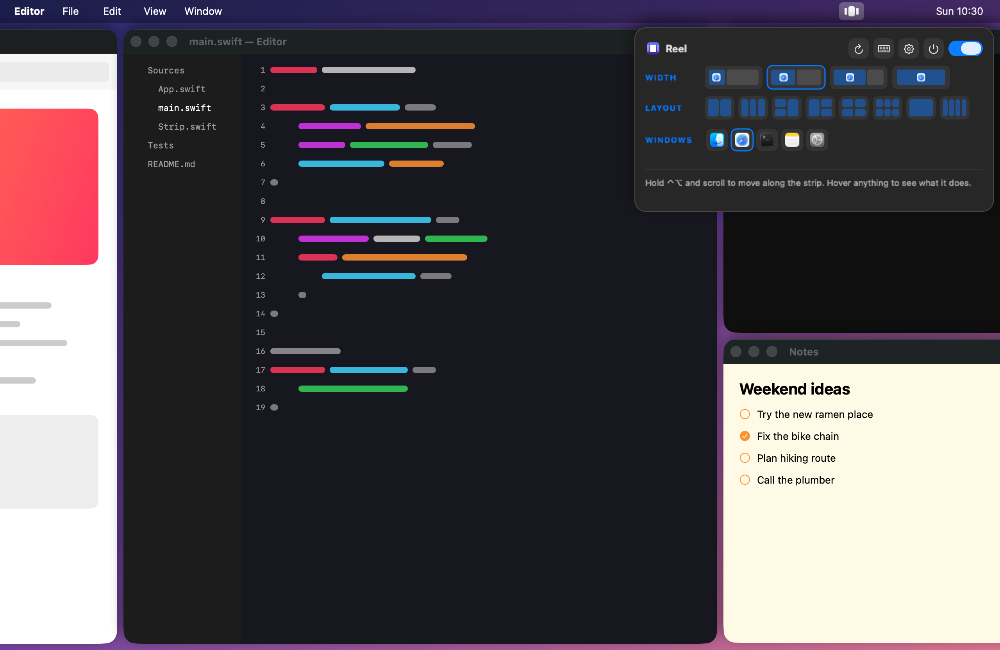

<p align="center">
  
</p>

<h1 align="center">Reel</h1>

<p align="center">A scrolling window manager for macOS.</p>

Your windows sit side by side on one horizontal strip per display. A new window
opens right next to the one you're using, and every window keeps the width you
gave it. You scroll along the strip instead of squeezing everything onto one
screen.

Reel lives in the menu bar, needs only the Accessibility permission, and never
connects to the network.

<p align="center">
  
</p>

## Requirements

- macOS 14 Sonoma or later
- Apple silicon or Intel

## Install

Reel isn't notarized yet, so for now you build it yourself. It takes about a
minute and needs Xcode 15+ or the Swift toolchain (`xcode-select --install`).

```bash
git clone https://github.com/Kiran-Alex/reel.git
cd reel
./scripts/build-app.sh
mv build/Reel.app /Applications/
open /Applications/Reel.app
```

On first launch:

1. macOS asks for **Accessibility** access. Turn on Reel in System Settings →
   Privacy & Security → Accessibility. Reel starts tiling as soon as it's
   allowed, without a restart.
2. Reel asks once whether to open at login. You can change this later in Settings.

## Using it

### Keyboard

| Action | Default keys |
|---|---|
| Focus left / right | ⌃⌥← / ⌃⌥→ |
| Focus up / down in a stack | ⌃⌥↑ / ⌃⌥↓ |
| Move window left / right | ⌃⌥⇧← / ⌃⌥⇧→ |
| Scroll strip left / right | ⌃⌥, / ⌃⌥. |
| Cycle width (⅓ → ½ → ⅔ → full) | ⌃⌥R |
| Center window | ⌃⌥C |
| Stack into the column on the left | ⌃⌥[ |
| Pop out of stack | ⌃⌥] |
| Re-tile everything | ⌃⌥T |

Every shortcut can be changed in Settings. Click it and press the new keys.

### Trackpad and mouse

- **Hold ⌃⌥ and scroll** (two fingers or the mouse wheel) to move along the
  strip. When you stop, the window you scrolled to gets focus and snaps into view.
- **Drag a window by its title bar** and drop it over another column to move it there.
- **Drag a window's edge** to resize it. That becomes its column's width.

### Menu bar panel

Click the Reel icon in the menu bar:

- **Width:** set the focused window to ⅓, ½, ⅔ or the full screen.
- **Layout:** regroup the strip into halves, thirds, stacks or grids, or back
  to one row at each window's original width.
- **Windows:** every window on the strip. Click one to jump to it.
- **Header buttons:** re-tile, keyboard shortcuts (⌨), Settings (⚙), quit, and
  an on/off switch.

### Turning it off

Switching tiling off or quitting Reel puts every window back to the position
and size it had before Reel touched it, including windows that have since
moved to another Space. While paused, Reel's shortcuts are released for other apps.

## Behaviour worth knowing

- **Minimum sizes:** if an app refuses to get as small as a layout asks, Reel
  gives it the room it needs and says so in the panel.
- **Windows keep their spot:** a window that leaves the strip comes back to the
  same position and width. That covers switching Spaces, ⌘H, minimizing and
  switching native tabs.
- **Frozen apps** are skipped for a few seconds at a time, so the rest of
  tiling stays smooth.
- **Losing permission:** if Accessibility access is switched off, Reel stops,
  shows a banner, and resumes once access is back.

## Known limitations

- **No three-finger swipe:** macOS doesn't let apps read three-finger swipes
  without private APIs. Use ⌃⌥ + scroll instead.
- **Stage Manager** moves windows on its own and fights Reel. The panel warns
  you when it's on.
- **One strip per display:** all Spaces on a display share one strip and its
  scroll position.
- **Native full-screen windows** are left alone, because they have their own Space.
- **Multiple displays:** columns scrolled off one screen are parked in a corner
  that doesn't touch another display. With displays on every side, a sliver
  may still show.

## Privacy

Reel has no network code, analytics or telemetry. It reads window positions,
sizes and app bundle IDs through the Accessibility API. It never reads window
titles or contents. It writes only these files:

| File | Contents |
|---|---|
| `~/.config/reel/config.json` | Your settings |
| `~/Library/Application Support/Reel/original-frames.json` | Window positions to restore when tiling is turned off. Deleted when you turn it off. |
| `~/Library/Logs/Reel.log` | Diagnostic log: window counts, sizes, app names. Capped at about 1 MB. |

## Uninstall

1. Quit Reel from the menu bar panel (⏻). Your windows go back to their original places.
2. Delete `/Applications/Reel.app`.
3. Remove Reel from System Settings → Privacy & Security → Accessibility, and
   from General → Login Items if you turned that on.
4. Optionally delete the three files listed under [Privacy](#privacy).

## Contributing

Bug reports and pull requests are welcome. See [CONTRIBUTING.md](CONTRIBUTING.md)
for how to build, test and debug. When reporting a bug, please include the
output of `Reel --diagnose`.

## License

Reel is free software, released under the [GNU General Public License v3.0](LICENSE).
You may use, study, share and change it. If you distribute a modified version,
you must release its source under the same license.

Copyright © 2026 Reel contributors.

Reel uses one private macOS API (`_AXUIElementGetWindow`, looked up at
runtime) to get stable window IDs, as most macOS window managers do.
